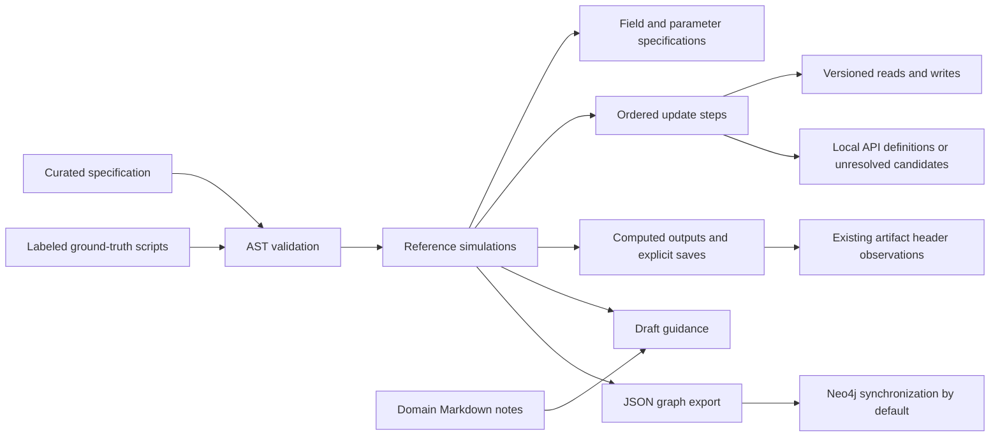

# Ground-truth domain knowledge graph

## Purpose

This graph describes **specific reference simulations** and the implementation
choices needed to reproduce them. It connects each reference to its fields,
parameters, ordered update operations, state dependencies, API definitions,
outputs, and curated guidance.

The constructor is
[`domain_knowledge_graph_creater.py`](domain_knowledge_graph_creater.py), preserving
the filename of the original starter. It uses the Python standard library for
local construction. Neo4j is the sole database target and is synchronized by
default; JSON is an inspection export. Construction does not run the
simulation scripts, import PhiFlow, call an LLM, download models, or generate
embeddings.

The semantic structure comes from the editable
[`domain_graph_spec.json`](domain_graph_spec.json). The actual code expressions,
statement locations, imports, and dependency reads/writes come from parsing the
labeled source files. The Markdown notes supply separately labeled guidance.
This is curated, source-validated extraction; it is not automatic ontology
discovery from arbitrary Python or prose.



## Files

| File | Role |
| --- | --- |
| `domain_knowledge_graph_creater.py` | Constructor, validation, JSON CLI, and Neo4j writer |
| `domain_graph_spec.json` | Curated profiles and API alias mappings |
| `domain_knowledge_graph.json` | Generated, inspectable graph snapshot |
| `domains/*.md` | Human-editable context, retrieval hints, and unresolved details |
| `test_domain_knowledge_graph.py` | Semantic and failure-mode tests |
| `requirements-neo4j.txt` | Neo4j database dependencies |
| `llm_context.md` | Guidance for using the knowledge in LLM prompts |

## Run the constructor

Python 3.10 or newer is required. From any working directory:

```powershell
python "D:\Vivek\research\knowledge_context\domain_knowledge_graph_creater.py"
```

This command builds the graph, saves an inspection export to
`D:\Vivek\research\knowledge_context\domain_knowledge_graph.json`, and synchronizes
Neo4j. Configure the connection settings described below before running it.
There is no database-selection flag; `--neo4j` is accepted only for compatibility
with earlier commands and has no additional effect. To inspect options:

```powershell
python "D:\Vivek\research\knowledge_context\domain_knowledge_graph_creater.py" --help
```

For validation or inspection without connecting to Neo4j:

```powershell
python "D:\Vivek\research\knowledge_context\domain_knowledge_graph_creater.py" --export-only
```

This export-only mode uses the Python standard library and does not read database
credentials. JSON is a file export, not an alternative graph database.

To select another local library checkout or output file:

```powershell
python "D:\Vivek\research\knowledge_context\domain_knowledge_graph_creater.py" --code-root "D:\Vivek\research\temp\PhiFlow" --output "D:\Vivek\research\knowledge_context\alternate_graph.json"
```

`--code-root` is the directory containing the `phi` package, not the `phi`
directory itself. It defaults to `ROOT/phiflow`. `--root` changes the project
root used to resolve profile source/note/artifact paths and the default
`knowledge_context/.env` location. `--spec` selects an
alternative specification. Supply both when moving the data to another project.

The CLI builds and validates the complete graph before replacing an export. It
writes through a temporary file. Validation failure leaves the prior JSON file
intact. Output filenames must end in `.json`; source, note, specification, and
constructor files cannot be used as output targets.

## Load into Neo4j

Install the database dependencies if needed:

```powershell
python -m pip install -r "D:\Vivek\research\knowledge_context\requirements-neo4j.txt"
```

Set `NEO4J_URI`, `NEO4J_USER`, and `NEO4J_PASSWORD` in
`D:\Vivek\research\knowledge_context\.env`. `NEO4J_DATABASE` is optional. The
template [.env.example](.env.example) lists the keys; enter the intended domain
graph's values in the actual `.env` file. Verify selection without connecting:

```powershell
python "D:\Vivek\research\knowledge_context\domain_knowledge_graph_creater.py" --check-config
```

This displays the exact selected file, URI, username, and requested database.
Passwords remain hidden. It performs no graph build, export, network connection,
or database writes. After checking the target, run normally:

```powershell
python "D:\Vivek\research\knowledge_context\domain_knowledge_graph_creater.py"
```

**The selected file is the sole credential source.** There is no fallback to the
project-root `.env` or inherited `NEO4J_*` process variables. Parsing uses
`dotenv_values(..., interpolate=False)` without modifying `os.environ`. `${...}`
references in required credentials are rejected, so interpolation cannot import
an old target from the shell or IDE.

`--env-file "path\to\file.env"` explicitly selects one other file; it is never
merged with the default file. The selected file must contain all three required
credentials. Missing files, blank/missing required values, unavailable
`python-dotenv`, or invalid URIs stop the CLI before building/exporting a graph
or connecting. An absent `NEO4J_DATABASE` uses the selected server's default;
it is not filled from an inherited setting.

After a complete file is validated, `--uri`, `--user`, and `--database` can
explicitly override the corresponding values. The password always comes from
the selected file. Overrides are logged as CLI-sourced. For example:

```powershell
python "D:\Vivek\research\knowledge_context\domain_knowledge_graph_creater.py" --uri "bolt://localhost:7687" --user "neo4j"
```

Connection selection is independent of the working directory. Environment-only
credential configuration is intentionally unsupported. The database engine is
fixed to Neo4j; the address and credentials remain configurable through the
selected file and explicit overrides.

The writer targets Neo4j 5+ syntax and driver 5 or 6 APIs. It verifies connectivity
and creates a uniqueness constraint on `:DomainKG(id)`. The account needs
permission to create that constraint and write the selected database.

All imported nodes carry the additional `DomainKG` label and a `dataset`
property. The default dataset is `ground_truth_domains`. Its IDs begin with
`dkg:ground_truth_domains:`. A single managed data transaction:

1. Merges nodes and relationships by ID and replaces their generated properties.
2. Removes stale relationships owned by this dataset between its managed nodes.
3. Removes stale `DomainKG` nodes owned by this dataset, with their relationships.

The schema constraint is created separately before the data transaction. A failed
data transaction rolls back its data changes. Rebuilding synchronizes a snapshot:
manual changes to generated properties are overwritten, and entities removed from
the specification are removed from that dataset. Add durable human knowledge to
the source notes or specification. Use a different `dataset` in a copied
specification for independent experiments. Avoid concurrent writers to one dataset.

The existing `TreeGen.py` code graph is outside this dataset. This writer does
not delete or rewrite its nodes. Stale managed-node deletion also removes any
manually added relationships attached to those stale nodes, including bridges to
other graphs.

The JSON export is completed before a database connection is attempted. If Neo4j
synchronization fails, the local export remains available and the CLI exits with
a failure status. No live database synchronization was performed during initial
implementation; the writer was tested with a mocked driver.

## Debug a Neo4j run

Normal runs now print timestamped progress automatically. For more detail and a
saved diagnostic file:

```powershell
python "D:\Vivek\research\knowledge_context\domain_knowledge_graph_creater.py" --debug --log-file "D:\Vivek\research\knowledge_context\neo4j_debug.log"
```

The output identifies:

- The script and Python interpreter being executed, working directory, and whether
  the mode is Neo4j synchronization or export only.
- The single selected credentials file, ignored inherited/root settings, selected server URI and
  username, requested database, and database actually reported by the server.
- Connectivity/authentication checks and identity-constraint creation.
- Dataset node/relationship counts before the transaction.
- Every node-label and relationship-type batch, submitted row counts, and server
  counters for creations, deletions, and properties set.
- Transaction attempts, confirmed commit, and counts read back after committing.

Batch-completion messages are marked **uncommitted** until `COMMIT confirmed`.
Managed transaction retries repeat those messages and increment the attempt
number. `VERIFIED` is printed only after committed node and relationship counts
match the exported graph. A verification error after `COMMIT confirmed` means
the transaction already committed; that subsequent check does not roll it back.

`--debug` also prints query text with parameter placeholders and error tracebacks.
Neo4j failures now include the underlying exception message and server error code
when present. Passwords and credentials embedded in server URIs are redacted, and
batch parameter values are not dumped. `--log-file` adds file output while keeping
console output; local `.log` files are ignored by Git.

If the run verifies successfully but Browser looks unchanged, select the database
shown as `actual database` and run the printed query:

```cypher
MATCH (n:DomainKG {dataset: 'ground_truth_domains'}) RETURN n LIMIT 100;
```

Repeated builds may create zero new entities because `MERGE` updates the existing
ones. An unchanged node count alone does not indicate a failed synchronization.
If the log reports the wrong target, override it with `--uri`, `--user`, or
`--database`, or correct the exact file printed as `Selected Neo4j credentials
file`. Run `--check-config` again before writing.

## Initial coverage

The initial checked-in specification contains these four profiles:

| Domain | Source | Distinctive recipe |
| --- | --- | --- |
| Burgers 2D | `test_burgers2d/burgers2d_ground_truth.py` | Noise-initialized vector field; implicit diffusion then self-advection |
| Heat flow | `test_heat_flow/heat_flow_ground_truth.py` | Mixed boundaries; spatial conductivity; implicit diffusion |
| Julia set | `test_julia_set/julia_set_ground_truth.py` | Persistent complex state; rotating parameter; cumulative threshold count |
| Reaction diffusion | `test_reaction_diffusion/reaction_diffusion_ground_truth.py` | Two periodic scalar fields; cached nonlinear reaction; explicit increments |

The structural-mechanics source is empty. No labeled source is present for
lid-driven cavity, smoke plume, or wake flow. These conditions appear in the
export's `report`; they produce no invented reference simulations. An additional
nonempty labeled file without a profile is reported as `unconfigured_source`.
It must receive a profile before its knowledge is ingested. A configured source
that disappears or becomes empty is a build error.

The first full local build contains 108 nodes and 178 relationships. These counts
are a snapshot, not an invariant: available artifacts, library definitions, note
sections, and profile changes can change them. Consult the export's `summary`.

## Node schema

Every node has `id`, `label`, and `properties` in JSON. In Neo4j it has labels
`DomainKG` and its semantic label, with those properties stored directly.

| Label | Meaning and principal properties |
| --- | --- |
| `Domain` | Broad domain; `name`. Reference-specific choices are scoped elsewhere. |
| `ReferenceSimulation` | One reference; `domain`, `imports`, full `source_text`, `update_scope_source`, and specification fingerprint |
| `FieldSpec` | Logical field; `variable`, `aliases`, initialization `expression`, curated `role` and `representation` |
| `ParameterSpec` | Selected module binding or function argument; original `expression`, optional `literal_json`, optional `parameter_kind` |
| `SourceDefinition` | Selected local helper function; full source `expression` |
| `UpdateStep` | A selected update statement; zero-based `order`, `expression`, `scope`, curated `name` |
| `ValueSpec` | A temporary produced by an update, such as cached `reaction` or rotating `c` |
| `OutputSpec` | Computed trajectory; `variable`, `expression`, curated `axis_order` and `initial_frame`, detected `save_status` |
| `SaveOperation` | Explicit module-level `np.save` call; literal `filename`, original `expression` |
| `Artifact` | Existing `.npy` header; `shape`, `dtype`, `fortran_order`, `header_sha256`, unverified production history |
| `Guidance` | Selected Markdown section; `name`, `text`, broad `condition`, `author`, draft review status |
| `CodeComponent` | Definition found statically in the selected local library; `qualified_name`, definition path/span/hash, `configured_aliases` |
| `ApiCandidate` | Observed call without a resolved local definition; `observed_call`, optional `configured_symbol`, and `reason` |

The stored `source_text` preserves the whole small reference for inspection. Only
configured fields, bindings, helpers, steps, and outputs become structured graph
entities. In particular, the reaction-diffusion plotting examples at the end of
its source do not become alternative trajectory initializers.

## Relationship schema

Every relationship has an ID, dataset ownership, and evidence properties.

| Type | Endpoints and purpose |
| --- | --- |
| `IN_DOMAIN` | Reference to broad domain |
| `HAS_FIELD` | Reference to initialized field specification |
| `HAS_PARAMETER` | Reference to selected binding or argument |
| `HAS_HELPER` | Reference to selected helper definition |
| `HAS_STEP` | Reference to update statement; also stores `order` |
| `NEXT_STEP` | Earlier update to the next configured update |
| `HAS_VALUE` | Reference to update-local temporary |
| `READS` | Update to field or temporary; `variable` and `state_version` identify the consumed state |
| `WRITES` | Update to field or temporary; records the assigned version |
| `USES_PARAMETER` | Update, initializer, helper, binding, or output to a referenced parameter |
| `USES_HELPER` | Expression or helper body references a selected helper, including passing it as an initializer |
| `CALLS_HELPER` | A direct call to a selected helper |
| `USES_API` | Owner to statically located library definition; retains observed spelling and configured alias |
| `USES_API_CANDIDATE` | Owner to unresolved observed API call |
| `PRODUCES` | Reference to computed output |
| `HAS_SAVE` | Output to its explicit save call |
| `HAS_ARTIFACT_OBSERVATION` | Output to an existing artifact associated by the curated profile |
| `GUIDED_BY` | Reference to separately labeled Markdown guidance |

API owners include update statements, field initializers, helper functions,
parameters, outputs, and saves. This covers construction and conversion APIs as
well as numerical operators.

## Evidence, review, and identity

Assertions retain these common properties:

| Property | Meaning |
| --- | --- |
| `source_path` | Repository-relative evidence path; external library roots use `code-root:` |
| `source_lines` | Inclusive `[start, end]` for text; empty list for binary-header observations |
| `source_sha256` | Hash of decoded text with normalized newlines, where applicable |
| `evidence_kind` | `source_fact`, `interpretation`, `artifact_observation`, `proposed_hint`, or `unresolved` |
| `review_status` | Initially `draft`; source verification does not imply human scientific review |

Actual expressions, detected save calls, and library definitions are source facts.
Read/write dependency analysis is labeled `interpretation`. Domain categorization
and profile-selected artifact association are also interpretations. Artifact header
properties are observations, not proof of reproduction or production history.

Field roles, representations, and step titles are **human-curated metadata**,
identified by `semantic_metadata_evidence="curated_profile"`. Output axis and
initial-frame conventions similarly carry `output_conventions_evidence`. Matching
an AST selector verifies the selected code, not arbitrary semantic metadata in
the profile. Review those properties when changing a reference.

Four Markdown sections are ingested: `Context to give an LLM`, `Retrieval hints`,
`Differences and unresolved details`, and `Human refinement`. Their prose remains
`proposed_hint` or `unresolved`, even if it describes source behavior. Placeholder
refinement text remains draft guidance. Markdown tables are not converted into
scientific facts. Review status is not automatically promoted on rebuild.

Node IDs are deterministic and dataset-scoped, for example:

```text
dkg:ground_truth_domains:domain:burgers2d
dkg:ground_truth_domains:reference:burgers2d:ground_truth
dkg:ground_truth_domains:reference:burgers2d:ground_truth:field:velocity
dkg:ground_truth_domains:reference:burgers2d:ground_truth:step:diffusion
dkg:ground_truth_domains:code:phi.physics.diffuse.implicit
```

Within a dataset, references share verified code-definition nodes. Fields,
parameters, temporaries, and steps remain reference-scoped. Relationship IDs hash
the endpoints, relationship type, and full evidence/properties; changed provenance
therefore changes an assertion's ID. Rebuild synchronization removes old
assertions. The export is sorted and carries `graph_sha256`, a fingerprint of the
canonical graph payload before that fingerprint is added. Identical inputs
produce identical JSON content and IDs; timestamps are not inserted.

## State versions and operation order

`state_version` describes assignments **within one update recipe**. Version 0 is
the field at entry to that recipe. A write increments its logical field's version.
These are static dependency labels, not saved simulation samples or global time
indices. Variable aliases in the profile identify one logical field; the
constructor does not infer aliasing across arbitrary Python objects.

For Burgers, diffusion reads velocity version 0 and writes version 1; advection
reads version 1 and writes version 2. Both arguments to self-advection use the
diffused field. The `NEXT_STEP` edge preserves that order.

For reaction diffusion:

| Update | Reads | Writes |
| --- | --- | --- |
| Cache reaction | u version 0, v version 0 | reaction version 1 |
| Update u | u version 0, reaction version 1 | u version 1 |
| Update v | v version 0, reaction version 1 | v version 1 |

Thus the second field update consumes the cached reaction rather than a reaction
recomputed from the new u. The graph preserves the literal expressions as well.

The heat step returns a new field without assignment. Its profile explicitly
maps that return to `temperature`; the read/write edges are derived using this
curated mapping. Julia's rotating `c` is a `ValueSpec`, while its complex state
and cumulative threshold count are distinct `FieldSpec` nodes.

## Outputs and array headers

An `OutputSpec` describes a computed result. Only an explicit module-level
`np.save(filename, expression)` referencing its variable creates a `SaveOperation`.
That limited detector handles the current references. Other aliases or save APIs
need extractor support. Julia therefore has `save_status="not_explicit"` despite
an existing reference `.npy` file on disk.

`initial_frame` comes from the profile. The two `iterate()` references retain
`library_default` because source syntax alone does not establish the installed
library's initial-frame convention. The reaction-diffusion and Julia profiles
state their explicitly curated inclusion/exclusion choices. Saved-header shapes
are separate observations; the constructor does not infer mathematical
correctness from their agreement with a profile.

Header inspection supports NPY versions 1, 2, and 3, uses literal parsing, caps
header size, and reads no array payload or pickle. Missing artifacts are reported;
invalid or truncated configured artifact headers fail the build. Payload shape,
finite values, dtype suitability, and scientific accuracy are not validated.

## API resolution and the existing code graph

`api_aliases` maps a call spelling such as `diffuse.implicit` to a candidate
qualified name such as `phi.physics.diffuse.implicit`. The resolver searches local
module files and package initializers, follows explicit `from ... import ...`
re-exports, and records the actual function/class definition. It does not import
or execute those modules. For example, `phi.field.CenteredGrid` resolves to the
definition in `phi.field._grid` in the current checkout.

`USES_API` means **the configured target definition exists in the selected local
source**. Its `binding_status` is `configured_alias_to_static_definition`; it does
not prove that a wildcard import in the reference selects that target at runtime.
Source identity and runtime compatibility still need review. Private canonical
definition paths are provenance, not recommended import locations for generated
simulation code; consult public exports and retrieved documentation.

Unresolved NumPy, PhiML, standard-library APIs, tensor instance methods, or
unconfigured aliases become `ApiCandidate` nodes. Add the appropriate local
source tree/alias mapping to resolve more definitions. The resolver deliberately
does not follow wildcard re-exports or search installed packages automatically.

Verified `CodeComponent` nodes belong to this domain graph. They are not merged
into `TreeGen.py`'s `Function`/`Class` nodes: those older nodes use basename-based
identifiers, which do not provide a reliable repository-qualified identity.
Any bridge should first reconcile repository path, qualified symbol, and source
version. The constructor does not create guessed links to legacy nodes.

## Example Neo4j queries

List the ordered Burgers recipe:

```cypher
MATCH (r:DomainKG:ReferenceSimulation {
  dataset: 'ground_truth_domains', domain: 'burgers2d'
})-[:HAS_STEP]->(s:UpdateStep)
RETURN s.order AS step, s.name AS operation, s.expression AS code,
       s.source_path AS source, s.source_lines AS lines
ORDER BY step;
```

Inspect reaction-diffusion data dependencies:

```cypher
MATCH (r:DomainKG:ReferenceSimulation {
  dataset: 'ground_truth_domains', domain: 'reaction_diffusion'
})-[:HAS_STEP]->(s:UpdateStep)-[dependency:READS|WRITES]->(value)
RETURN s.order AS step, s.name AS operation, type(dependency) AS access,
       value.name AS value, dependency.variable AS variable,
       dependency.state_version AS version
ORDER BY step, access, value;
```

Find verified numerical APIs and unresolved candidates:

```cypher
MATCH (r:DomainKG:ReferenceSimulation {dataset: 'ground_truth_domains'})
      -[:HAS_STEP]->(s:UpdateStep)
OPTIONAL MATCH (s)-[:USES_API]->(api:CodeComponent)
OPTIONAL MATCH (s)-[:USES_API_CANDIDATE]->(candidate:ApiCandidate)
RETURN r.domain AS domain, s.name AS operation,
       collect(DISTINCT api.qualified_name) AS definitions,
       collect(DISTINCT candidate.observed_call) AS unresolved_calls;
```

Retrieve context for a chosen domain:

```cypher
MATCH (r:DomainKG:ReferenceSimulation {
  dataset: 'ground_truth_domains', domain: 'heat_flow'
})-[:GUIDED_BY]->(g:Guidance)
RETURN g.name AS section, g.text AS text, g.evidence_kind AS evidence,
       g.source_path AS source, g.source_lines AS lines;
```

Distinguish a computed output from its explicit saves:

```cypher
MATCH (r:DomainKG:ReferenceSimulation {dataset: 'ground_truth_domains'})
      -[:PRODUCES]->(o:OutputSpec)
OPTIONAL MATCH (o)-[:HAS_SAVE]->(save:SaveOperation)
RETURN r.domain AS domain, o.variable AS variable, o.save_status AS save_status,
       collect(save.filename) AS explicit_filenames;
```

## Add or revise a reference profile

1. Add a nonempty labeled `<domain>_ground_truth.py` source and inspect it.
2. Draft a domain note using `domain_template.md`. Record discrepancies separately.
3. Add one profile under `references` in the specification. Current schema version
   1 allows one reference per domain. Paths must stay inside the project root.
4. Specify each logical field's module assignment variable and aliases used in the
   update. Select module bindings and local helper functions needed for context.
5. Select `update_scope`: `function:<name>` or `loop`. The latter requires one
   module-level for loop. List steps in source order with unique stable IDs and
   exact single-statement `code` selectors.
6. Add output assignment selectors, axis/initial-frame conventions, and optional
   artifact paths. Their semantic metadata needs human review.
7. Add missing call-spelling aliases, run with `--export-only`, and inspect the
   graph and its report. Run normally to synchronize it to Neo4j.

An example step entry:

```json
{
  "id": "diffusion",
  "name": "Implicit diffusion",
  "code": "v = diffuse.implicit(v, 0.1, dt=dt)"
}
```

Selectors compare parsed AST structure; whitespace, formatting, and line-number
changes do not break them. Changed coefficients, operators, argument names, or
other semantic edits do. Source spans and hashes are always refreshed.

The current extractor accepts simple name assignments and configured return
statements as steps. Unselected bare returns of known state and list `.append()`
capture calls are allowed and remain visible in `update_scope_source`. Every
other unconfigured update statement fails validation, as do reordered selectors,
duplicate IDs, ambiguous module assignments, and unsupported branching/nested
control flow. `.append()` handling assumes trajectory capture; custom mutable
state logic needs an extractor extension. The constructor is not a general
Python dataflow or interprocedural analysis engine.

All facts and guidance start as draft. To change review-state handling durably,
extend the profile and constructor together; editing only generated JSON or
database properties will not survive a rebuild.

## Programmatic use and LLM integration

From the project root, the namespace-package import works without installation:

```python
from knowledge_context.domain_knowledge_graph_creater import KnowledgeGraphBuilder

graph = KnowledgeGraphBuilder().build()
steps = [
    node for node in graph['nodes']
    if node['label'] == 'UpdateStep'
    and node['properties']['source_path'].startswith('test_burgers2d/')
]
for step in sorted(steps, key=lambda node: node['properties']['order']):
    print(step['properties']['expression'])
```

`build()` returns a graph dictionary and performs no output/database writes.
`write_neo4j(graph, uri, user, password, database=None)` is a separate operation.
It rejects empty, cross-dataset, or dangling graph data before connecting.

To supply context to an LLM, retrieve the matching reference, its initializers,
parameters/helpers, ordered steps, dependency edges, output conventions, and
relevant guidance. Include API documentation for executable code generation.
Keep `ApiCandidate` and draft guidance status visible in the serialized prompt.

The existing `llm-querying.py` still traverses its older code-schema relations.
It does not automatically retrieve this new graph. Integrating it requires a
domain-selection/context-serialization step before `generate_search_blueprint()`
and/or `generate_grounded_code()`. Embedding indexes and LLM-generated enrichment
are possible later additions with their own provenance; the current constructor
has no API-key or embedding-model requirement.

## Validation

Run the focused tests:

```powershell
python -m unittest discover -s "D:\Vivek\research\knowledge_context" -p test_domain_knowledge_graph.py -v
```

The tests cover operation order, field versions, the shared reaction cache,
coefficient-field reads, helper/parameter dependencies, unresolved API handling,
computed-vs-saved outputs, provenance, repeatable IDs, missing/empty sources,
stale selectors, extra statements, path containment, malformed headers, export
preservation after validation failure, and parameterized dataset-scoped Neo4j
writes using a mocked driver. Additional CLI tests cover Neo4j as the default,
export-only mode, explicit connection overrides, and missing settings. Config
regression tests cover conflicting root/inherited settings, absent/incomplete
selected files, explicit alternate files, disabled interpolation, dependency
failures, URI validation, and `--check-config` making no connection. Diagnostic
tests cover progress stages, post-commit count mismatches, redacted console/file
logging, and underlying error messages/tracebacks. All 35 tests
pass; they require no live database or simulation run.

The initial implementation was also run on the actual four sources and existing
array headers using `python -S` with `--export-only`, confirming validation/export works without
site-packages. Simulations were not rerun; mathematical accuracy, numerical
equivalence, and actual Neo4j server behavior remain separate validation steps.
